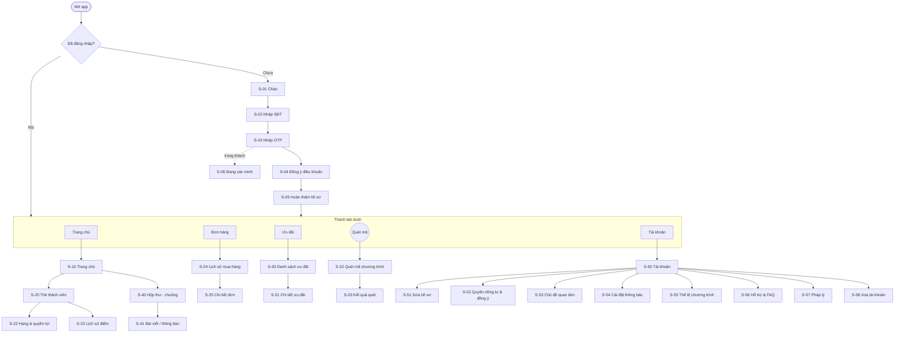
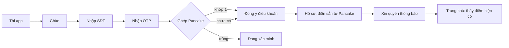
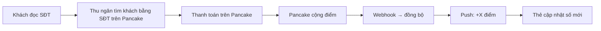

# 04 — Kiến trúc thông tin và luồng người dùng

> MiwaCare · v1 · 2026-11-25 · Mã màn hình `S-xx`, mã chức năng `F-xx` theo `03`.

## 1. Sơ đồ màn hình (sitemap) — App



## 2. Danh sách màn hình

| Mã | Màn hình | Nội dung chính | Chức năng | Điều hướng tới |
|---|---|---|---|---|
| S-01 | Chào | Logo, 1–3 trang giới thiệu, "Bắt đầu" | F-01 | S-02 |
| S-02 | Nhập SĐT | Ô SĐT, nút "Nhận mã" | F-02 | S-03 |
| S-03 | Nhập OTP | 6 ô số, đếm ngược gửi lại 60 giây | F-02, F-04 | S-04 / S-06 / Trang chủ |
| S-04 | Đồng ý | 1 ô bắt buộc + 2 ô tuỳ chọn, link chính sách | F-03 | S-05 |
| S-05 | Hoàn thiện hồ sơ | Họ tên, ngày sinh, giới tính | F-05 | Trang chủ |
| S-06 | Đang xác minh | Giải thích + liên hệ hỗ trợ | F-04 | — |
| S-10 | Trang chủ | Chào theo tên, chuông hộp thư, thẻ rút gọn, điểm, lối tắt (Quét mã · Ưu đãi · Lịch sử điểm · Đơn hàng), ưu đãi, đơn gần nhất | F-24 | S-20, S-31, S-32, S-40 |
| S-20 | Thẻ thành viên | Thẻ đầy đủ (không có mã khách), điểm, hạng, tiến độ | F-10–F-12 | S-22, S-23 |
| S-22 | Hạng & quyền lợi | Các hạng, điều kiện, quyền lợi, vị trí của khách | F-12 | — |
| S-23 | Lịch sử điểm | Danh sách +/−, lọc theo tháng | F-13 | — |
| S-24 | Lịch sử mua | Danh sách đơn | F-14 | S-25 |
| S-25 | Chi tiết đơn | Sản phẩm, số lượng, tổng, điểm nhận | F-14 | — |
| S-30 | Ưu đãi | Thẻ ưu đãi, lọc "Dành cho bạn" / "Tất cả" | F-20 | S-31 |
| S-31 | Chi tiết ưu đãi | Mô tả, điều kiện, hạn, hướng dẫn dùng | F-21 | — |
| S-32 | Quét mã chương trình | Camera + khung quét, đèn flash, nhập mã tay, chọn ảnh | F-25 | S-33 |
| S-33 | Kết quả quét | Thành công: chương trình + quà, \"Xem trong Ưu đãi\". Lỗi: mã sai / hết hạn / hết lượt / đã nhận | F-25 | S-30, S-10 |
| S-40 | Hộp thư | Danh sách, chấm chưa đọc | F-22 | S-41 |
| S-41 | Bài viết | Ảnh, tiêu đề, nội dung | F-23 | — |
| S-50 | Tài khoản | Thông tin tóm tắt + menu | F-30–F-35 | S-51–S-58 |
| S-51 | Sửa hồ sơ | Form | F-30 | — |
| S-52 | Quyền riêng tư | 2 công tắc đồng ý + lịch sử đồng ý | F-31 | — |
| S-53 | Chủ đề quan tâm | Chip chọn nhiều | F-32 | — |
| S-54 | Thông báo | 3 công tắc + trạng thái quyền hệ điều hành | F-33 | — |
| S-55 | Thể lệ | Nội dung tĩnh | F-16 | — |
| S-56 | Hỗ trợ | Hotline, Zalo OA, cửa hàng, FAQ | F-34 | — |
| S-57 | Pháp lý | Link chính sách, điều khoản, phiên bản | F-35 | — |
| S-58 | Xoá tài khoản | Cảnh báo, xác nhận OTP | F-07 | S-02 |

## 3. Sơ đồ trang quản trị (web)

```
Đăng nhập (2FA)
├── Tổng quan                      F-71
├── Thành viên                     F-72
│   └── Chi tiết thành viên
├── Khách trùng cần xử lý          F-73
├── Phân khúc                      F-74
├── Nội dung
│   ├── Bài viết                   F-75
│   └── Nội dung tĩnh (thể lệ, FAQ, liên hệ, chủ đề)  F-78
├── Chiến dịch                     F-76, F-77
├── Ưu đãi riêng (Could)           F-80
├── Nhật ký đồng bộ / thao tác     F-79
└── Người dùng quản trị (admin)    F-70
```

## 4. Luồng người dùng chính

### UF-1. Lần đầu dùng app

**Điểm nhấn:** khách cũ thấy ngay số điểm đã tích từ trước. Đây là lúc "à, hay đấy" quan trọng nhất.

### UF-2. Mua hàng tại quầy và nhận điểm


### UF-3. Dùng điểm tại quầy
Khách đọc SĐT → thu ngân chọn dùng điểm trên Pancake → Pancake trừ điểm → app nhận thay đổi → push "Bạn đã dùng X điểm, còn Y".

### UF-4. Nhận và mở thông báo khuyến mãi
Push → chạm → mở thẳng S-41 (bài viết) hoặc S-31 (ưu đãi) → nút "Dùng tại quầy: đọc SĐT cho thu ngân".

### UF-4b. Quét mã chương trình (giai đoạn sau)
Thương hiệu tạo chương trình (F-81) → gửi mã QR qua push / Zalo / tờ rơi / sự kiện → khách chạm nút Quét ở giữa thanh tab (S-32) → server kiểm tra mã → S-33 báo kết quả, quà được lưu vào Ưu đãi.

### UF-5. Xoá tài khoản
Tài khoản → Xoá tài khoản → đọc cảnh báo → nhập OTP → xác nhận → đăng xuất → về S-02.

### UF-6. Người vận hành gửi chiến dịch
Tạo phân khúc → xem trước số khách → soạn bài → tạo chiến dịch → `admin` duyệt → gửi / hẹn giờ → xem báo cáo.

## 5. Trạng thái đặc biệt cần thiết kế

| Trạng thái | Ở đâu | Cách hiển thị |
|---|---|---|
| Đang tải | Mọi danh sách | Khung xương (skeleton), không dùng vòng xoay toàn màn hình |
| Trống | Lịch sử điểm, đơn, hộp thư, ưu đãi | Hình minh hoạ + câu hướng dẫn ("Mua hàng để bắt đầu tích điểm") |
| Mất mạng | Toàn app | Thanh mỏng "Đang ngoại tuyến"; vẫn hiện thẻ và điểm đã lưu |
| Dữ liệu cũ | Thẻ, điểm | "Cập nhật lúc hh:mm" |
| Lỗi | Mọi nơi gọi API | Câu dễ hiểu + nút "Thử lại"; không hiện mã lỗi kỹ thuật |
| Chưa bật thông báo | Trang chủ, S-54 | Thẻ nhắc nhẹ, có nút mở cài đặt hệ điều hành |
| Đang xác minh tài khoản | S-06 | Giải thích + liên hệ hỗ trợ |
