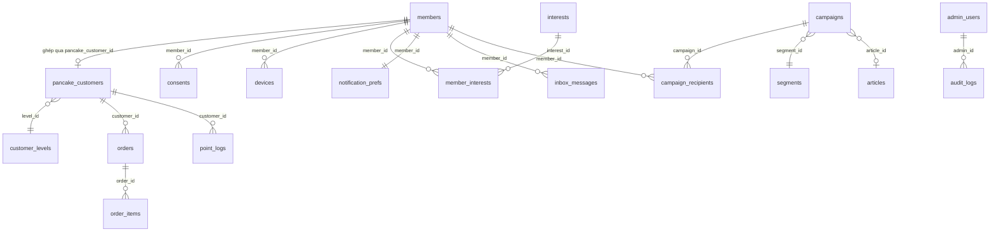

# 06 — Kiến trúc kỹ thuật và dữ liệu

> MiwaCare · v1 · 2026-11-25 · Bổ sung chi tiết cho `01` mục 1 và 3.

## 1. Công nghệ

| Lớp | Lựa chọn | Lý do |
|---|---|---|
| App | **Expo (React Native) + TypeScript**, Expo Router | Một codebase cho iOS và Android; build và cập nhật qua EAS |
| Trạng thái và dữ liệu (app) | TanStack Query + Supabase JS client | Cache, tự thử lại, đồng bộ realtime dễ |
| Form và kiểm tra dữ liệu | react-hook-form + zod | Dùng chung schema zod với backend |
| Lưu trữ an toàn | expo-secure-store | Token đăng nhập |
| Push | expo-notifications + Expo Push Service | Một API cho APNs và FCM |
| Quét QR chương trình | expo-camera (có sẵn quét mã vạch/QR) | Không cần thư viện quét riêng; giai đoạn sau |
| Backend | **Supabase**: Postgres, Auth, Edge Functions (Deno/TS), Realtime, Cron (pg_cron), Storage | Một nền tảng, không phải quản lý server |
| Hàng đợi | Bảng Postgres (`sync_queue`, `push_queue`) + `pgmq` nếu cần | Đủ cho quy mô một thương hiệu |
| Trang quản trị | **Vite + React** (web tĩnh) + Supabase, triển khai trên **Cloudflare Pages** (miễn phí, cho thương mại) | Không cần máy chủ Node; thao tác đặc quyền qua Edge Functions |
| Web công khai | Cùng dự án trên Cloudflare Pages (các trang `/chinh-sach`, `/dieu-khoan`, `/xoa-tai-khoan`) | Một chỗ triển khai |
| Giám sát | Sentry (app + Edge Functions + admin) | Theo dõi crash và lỗi |
| Cảnh báo | Telegram bot + email | Nhanh, rẻ |
| Mã nguồn | GitHub (private), monorepo | Chia sẻ type và schema |
| CI/CD | GitHub Actions + EAS Build / Submit / Update | Tự động hoá |

## 2. Cấu trúc thư mục (monorepo)

```
miwacare/
├── apps/
│   ├── mobile/            # Expo app
│   │   ├── app/           # Expo Router: (auth)/, (tabs)/, ...
│   │   └── src/{ui,theme,features,lib,i18n}
│   └── admin/             # Vite + React: quản trị + web công khai (Cloudflare Pages)
├── packages/
│   ├── shared/            # zod schema, type, hằng số, định dạng tiền/điểm
│   └── pancake/           # client Pancake: gọi API, chuẩn hoá, retry, rate limit
├── supabase/
│   ├── migrations/        # SQL schema + RLS
│   ├── functions/         # Edge Functions
│   └── seed.sql           # dữ liệu mẫu cho dev
└── docs/
```

## 3. Môi trường

| Môi trường | Supabase | Pancake | App | Dùng cho |
|---|---|---|---|---|
| `dev` | Project dev | Shop thử / dữ liệu thử | Expo Go / development build | Phát triển |
| `staging` | Project staging | Shop thử | Kênh EAS `preview` (TestFlight, Internal testing) | Kiểm thử, test kín 14 ngày |
| `production` | Project prod | Shop thật | Kênh EAS `production` | Khách thật |

Khoá bí mật của từng môi trường để riêng, không dùng chung.

## 4. Mô hình dữ liệu

### 4.1 Phân loại nguồn gốc
- 🟦 **Bản sao từ Pancake** (chỉ hệ thống đồng bộ được ghi): `pancake_customers`, `customer_levels`, `orders`, `order_items`, `point_logs`, `pancake_vouchers`, `pancake_promotions`.
- 🟩 **Gốc tại MiwaCare**: `members`, `consents`, `devices`, `interests`, `member_interests`, `notification_prefs`, `articles`, `inbox_messages`, `segments`, `campaigns`, `campaign_recipients`, `static_pages`, `admin_users`, `audit_logs`.
- ⬜ **Kỹ thuật**: `sync_queue`, `sync_runs`, `sync_cursors`, `point_events`, `push_queue`, `otp_attempts`, `duplicate_matches`.

### 4.2 Sơ đồ quan hệ (ERD rút gọn)



### 4.3 Các bảng chính

**`members`** 🟩
| Cột | Kiểu | Ghi chú |
|---|---|---|
| `id` | uuid PK | = `auth.users.id` |
| `phone` | text unique | Đã chuẩn hoá `0xxxxxxxxx` |
| `pancake_customer_id` | text unique null | Null khi đang chờ xử lý trùng |
| `link_status` | enum `linked` / `pending_duplicate` / `creating` | |
| `full_name`, `birth_date`, `gender`, `email` | | Hồ sơ do khách nhập |
| `created_at`, `last_active_at`, `deleted_at` | timestamptz | `deleted_at` để xoá mềm (BR-11) |

**`pancake_customers`** 🟦
| Cột | Nguồn Pancake |
|---|---|
| `id` (PK) | `id` |
| `name`, `phone_numbers` (text[]), `date_of_birth`, `gender`, `emails` | như tên |
| `reward_point` (int) | `reward_point` |
| `level_id` | `level_id` |
| `tags` (text[]) | `tags` |
| `order_count`, `succeed_order_count`, `purchased_amount` (bigint) | như tên |
| `last_order_at`, `pancake_updated_at` | `last_order_at`, `updated_at` |
| `synced_at` | thời điểm MiwaCare đồng bộ |

**`orders`** 🟦: `id`, `customer_id`, `status` (int), `status_name`, `buyer_paid_amount`, `total_discount`, `discount_by_customer_level`, `inserted_at`, `pancake_updated_at`, `synced_at`.
**`order_items`** 🟦: `order_id`, `product_id`, `variation_id`, `name`, `quantity`, `retail_price`, `discount_each_product`.
**`point_logs`** 🟦: `id` (sinh từ hash của customer + inserted_at + amount nếu Pancake không có id), `customer_id`, `amount`, `current_point`, `note`, `inserted_at`.
**`customer_levels`** 🟦: `id`, `name`, `color`, `discount`, `discount_type`, `upgrade_by_point`, `upgrade_by_total_purchase`, `upgrade_by_order_count`.

**`consents`** 🟩 (chỉ thêm, không sửa, không xoá)
| Cột | Ghi chú |
|---|---|
| `id`, `member_id` | |
| `purpose` | `terms` / `marketing` / `personalization` |
| `granted` | bool |
| `policy_version` | ví dụ `2026-12-01` |
| `source` | `app` / `web` |
| `device_info`, `ip_hash` | Bằng chứng đồng ý |
| `created_at` | |

**`devices`** 🟩: `id`, `member_id`, `expo_push_token`, `platform`, `app_version`, `last_seen_at`, `disabled_at`.

**`segments`** 🟩: `id`, `name`, `definition` (jsonb: các điều kiện lọc), `created_by`, `updated_at`. Truy vấn sinh ra từ `definition` qua một hàm SQL có kiểm soát, **không** nhận SQL tự do.

**`campaigns`** 🟩: `id`, `name`, `type` (`promotion` / `info` / `transactional`), `segment_id`, `article_id`, `title`, `body`, `deep_link`, `channels` (push / inbox), `scheduled_at`, `status` (`draft` / `pending_approval` / `approved` / `sending` / `sent` / `canceled`), `created_by`, `approved_by`.

**`audit_logs`** 🟩: `id`, `actor_type` (admin / system), `actor_id`, `action`, `target`, `metadata`, `created_at`. Chỉ thêm, không sửa, không xoá.

**`sync_queue`** ⬜: `id`, `entity` (`customer` / `order`), `entity_id`, `reason` (`webhook` / `reconcile` / `manual`), `status`, `attempts`, `next_run_at`, `last_error`, `created_at`. Unique theo (`entity`, `entity_id`, `status='pending'`) để gộp sự kiện trùng.

**`sync_cursors`** ⬜: `name` (`orders_recent`, `customers_recent`, `nightly`), `last_success_at`.

### 4.4 View phục vụ app
- `v_my_member_card`: ghép `members` + `pancake_customers` + `customer_levels`, tính sẵn `next_level`, `progress_percent`, `remaining_to_next`. RLS: chỉ dòng của chính khách.
- `v_my_point_history`, `v_my_orders`: lọc theo `pancake_customer_id` của khách đang đăng nhập.
- `v_my_offers`: voucher và khuyến mãi còn hiệu lực, lọc theo hạng và tag của khách.

### 4.5 View phục vụ CRM
- `v_member_rfm`: `recency_days`, `frequency_12m`, `monetary_12m`, điểm R/F/M từ 1–5, nhãn nhóm (VIP, trung thành, có nguy cơ rời, mới…).
- `v_member_product_affinity`: nhóm sản phẩm mua nhiều nhất của từng khách.

## 5. Tích hợp Pancake (gói `packages/pancake`)
- Một client duy nhất: gắn `api_key`, giới hạn ≤ 20 request/giây (dưới ngưỡng 30), thử lại với 429/5xx có backoff và tôn trọng `Retry-After`.
- Hàm chuẩn hoá: SĐT, tiền (VND là số nguyên), thời gian (UTC → lưu `timestamptz`).
- Bảng ánh xạ trạng thái đơn: **chỉ** đặt sau khi test thực tế (tài liệu Pancake không định nghĩa trạng thái nào là "hoàn tất").
- Có bộ test hợp đồng (contract test) chạy hằng ngày trên shop thử để sớm phát hiện khi Pancake đổi API.

## 6. Hiệu năng và quy mô
- Quy mô dự kiến [GIẢ ĐỊNH]: dưới 50.000 khách, dưới 2.000 đơn/ngày → gói Supabase Pro dư sức.
- Index: `members(phone)`, `pancake_customers(pancake_updated_at)`, `orders(customer_id, inserted_at desc)`, `point_logs(customer_id, inserted_at desc)`, `sync_queue(status, next_run_at)`.
- Realtime chỉ bật cho các bảng app cần (`pancake_customers`, `inbox_messages`), có lọc theo khách.

## Bổ sung 2026-11-25: Chương trình và mã QR (giai đoạn sau)
App không có mã khách; tại quầy nhận diện bằng SĐT. Mã QR chỉ dùng cho chương trình riêng (F-25, F-81). Bảng 🟩 dữ liệu riêng:

| Bảng | Cột chính |
|---|---|
| `programs` | id, tên, mô tả, bắt đầu, kết thúc, quà (voucher Pancake / nội dung), số lượt tối đa, phân khúc được nhận (null = tất cả), trạng thái |
| `program_codes` | code (ngẫu nhiên ≥ 10 ký tự, duy nhất), program_id, loại (dùng chung / dùng 1 lần), số lượt đã dùng |
| `program_claims` | program_id, member_id, code, thời điểm, kết quả quà (id voucher Pancake). Khoá duy nhất (program_id, member_id) |

Edge Function `program-claim`: nhận code từ app (đã đăng nhập) → kiểm tra hạn, lượt, phân khúc, đã nhận chưa → ghi `program_claims` trong 1 transaction → nếu quà là voucher thì gọi Pancake. Giới hạn 5 lần sai / 10 phút / khách. Nội dung QR chỉ là `miwacare://p/<code>` (mở app nếu đã cài).
