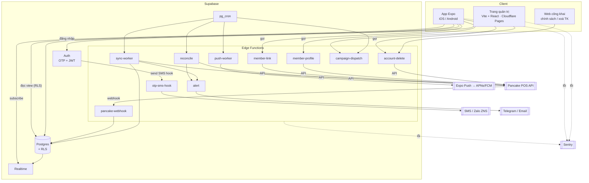

# 08 — Phân tích thiết kế hệ thống

> MiwaCare · v1 · 2026-11-25 · Chi tiết hoá `06` thành các module, giao tiếp và cách xử lý lỗi.

## 1. Sơ đồ thành phần

## 2. Module và trách nhiệm

| Module | Loại | Trách nhiệm | Gọi Pancake? |
|---|---|---|---|
| `pancake-webhook` | Edge Function (HTTP) | Kiểm tra header bí mật, ghi `sync_queue`, trả 200 | Không |
| `sync-worker` | Edge Function (cron mỗi phút + gọi ngay khi có webhook) | Xử lý `sync_queue`: đọc lại Pancake, upsert, phát sự kiện thay đổi điểm | Đọc |
| `reconcile` | Edge Function (cron 5 phút / 2h sáng) | Kéo dữ liệu theo `updated_at`, so sánh, sửa, báo cáo | Đọc |
| `catalog-sync` | Edge Function (cron mỗi giờ) | Hạng, voucher, khuyến mãi | Đọc |
| `member-link` | Edge Function (app gọi sau OTP) | Ghép / tạo khách Pancake, ghi tag | Đọc + ghi |
| `member-profile` | Edge Function (app gọi) | Cập nhật hồ sơ ở MiwaCare và Pancake | Đọc + ghi |
| `account-delete` | Edge Function (app / web gọi) | Xoá mềm, huỷ token, gỡ tag, lên lịch xoá cứng | Ghi |
| `campaign-dispatch` | Edge Function (cron + admin) | Tính danh sách nhận, tạo `inbox_messages`, đẩy vào `push_queue` | Không |
| `push-worker` | Edge Function (cron 30 giây) | Gửi Expo Push theo lô 100, xử lý receipt | Không |
| `otp-sms-hook` | Edge Function (Auth hook) | Gửi OTP qua nhà cung cấp Việt Nam | Không |
| `alert` | Hàm dùng chung | Gửi Telegram / email | Không |

**Quy tắc:** app và trang quản trị **không** giữ khoá Pancake. Chỉ các Edge Function mới gọi Pancake, qua gói `packages/pancake`.

## 3. Giao tiếp (API) mà app dùng

| Thao tác | Cách gọi | Ghi chú |
|---|---|---|
| Gửi / xác nhận OTP | `supabase.auth.signInWithOtp({ phone })`, `verifyOtp` | |
| Ghép tài khoản | `POST /functions/v1/member-link` | Trả `linked` / `pending_duplicate` |
| Lưu đồng ý | `insert` vào `consents` (RLS: chỉ chính mình, chỉ insert) | |
| Thẻ, điểm, hạng | `select` từ `v_my_member_card` | + subscribe realtime `pancake_customers` lọc theo id |
| Lịch sử điểm / đơn | `select` từ `v_my_point_history`, `v_my_orders` (phân trang) | |
| Ưu đãi | `select` từ `v_my_offers` | Lọc theo hạng, tag, thời hạn |
| Hộp thư | `select` / `update read_at` trên `inbox_messages` | + realtime |
| Hồ sơ | `POST /functions/v1/member-profile` | Ghi cả Pancake |
| Đăng ký thiết bị | `upsert` vào `devices` | |
| Xoá tài khoản | `POST /functions/v1/account-delete` | Yêu cầu OTP vừa xác nhận |

## 4. Thiết kế các điểm khó

### 4.1 Chống trùng và sai thứ tự sự kiện
- `sync_queue` unique theo (`entity`, `entity_id`) khi đang `pending`: 10 webhook liên tiếp của cùng một khách chỉ xử lý **một lần**.
- Upsert có điều kiện: chỉ ghi khi `pancake_updated_at` mới hơn bản đang lưu.

### 4.2 Phát hiện "điểm thay đổi" để gửi push
- Trigger trên `pancake_customers`: khi `reward_point` đổi, ghi `point_events` (cũ, mới, chênh lệch) → tạo `inbox_messages` + `push_queue` kiểu giao dịch.
- Nạp dữ liệu ban đầu và đối soát đêm thì **tắt** push, tránh gửi hàng loạt thông báo sai ngữ cảnh.

### 4.3 Ghi về Pancake an toàn
- Trước mỗi `PUT /customers/{id}`: `GET` bản mới nhất → gộp thay đổi (đặc biệt `tags`) → `PUT` → `GET` lại để xác nhận → ghi `audit_logs`.
- Khoá theo khách (advisory lock trên `customer_id`): không có hai lệnh ghi cùng lúc vào một khách.

### 4.4 Khi Pancake lỗi hoặc chậm
- Hàng đợi tự thử lại với backoff (1 phút, 5 phút, 15 phút, 1 giờ), quá 6 lần thì chuyển `failed` và cảnh báo.
- App vẫn chạy bằng dữ liệu trong Postgres, hiển thị "cập nhật lúc…".
- Đăng ký mới khi Pancake lỗi: cho vào app với trạng thái `creating`, worker hoàn tất sau.

### 4.5 Phân khúc an toàn
- `segments.definition` là JSON có cấu trúc cố định (trường, toán tử, giá trị), được kiểm tra bằng zod và biên dịch thành truy vấn qua hàm SQL `segment_members(definition)`. Không chạy SQL tự do do người dùng nhập.
- Chiến dịch loại `promotion` tự `JOIN` với đồng ý `marketing = true` mới nhất.

## 5. Xử lý lỗi và quan sát
- Mọi Edge Function ghi log có cấu trúc (JSON): `request_id`, `function`, `entity_id`, `duration_ms`, `result`. **Không** ghi SĐT đầy đủ hay token.
- Lỗi gửi Sentry kèm `request_id`.
- Bảng `sync_runs` + trang "Nhật ký đồng bộ" trong quản trị.
- Cảnh báo: xem F-57.

## 6. Kiểm thử
| Cấp | Nội dung | Công cụ |
|---|---|---|
| Đơn vị | Chuẩn hoá SĐT, tính tiến độ hạng, biên dịch phân khúc, định dạng tiền | Vitest |
| Tích hợp | Edge Function với Postgres cục bộ; Pancake giả lập (mock) | Supabase CLI + Vitest |
| Hợp đồng Pancake | Gọi shop thử thật, kiểm tra trường và kiểu dữ liệu | Chạy hằng ngày trên CI |
| RLS | Khách A không đọc được dữ liệu khách B | Test SQL (pgTAP) |
| App | Component + luồng chính | Jest + React Native Testing Library; Maestro cho luồng end-to-end |
| Thủ công | Danh sách kiểm tra trên iPhone + Android thật trước mỗi bản phát hành | Checklist trong `11` |
