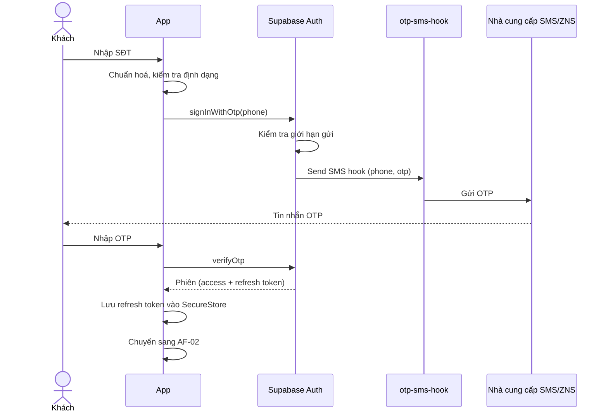
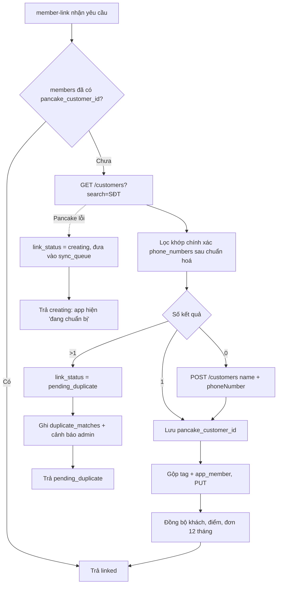
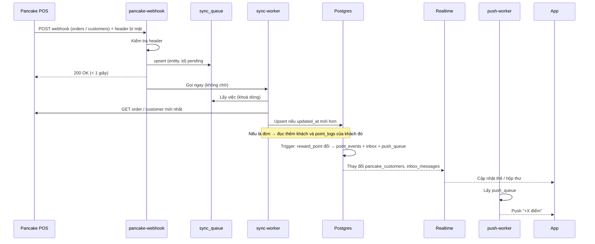
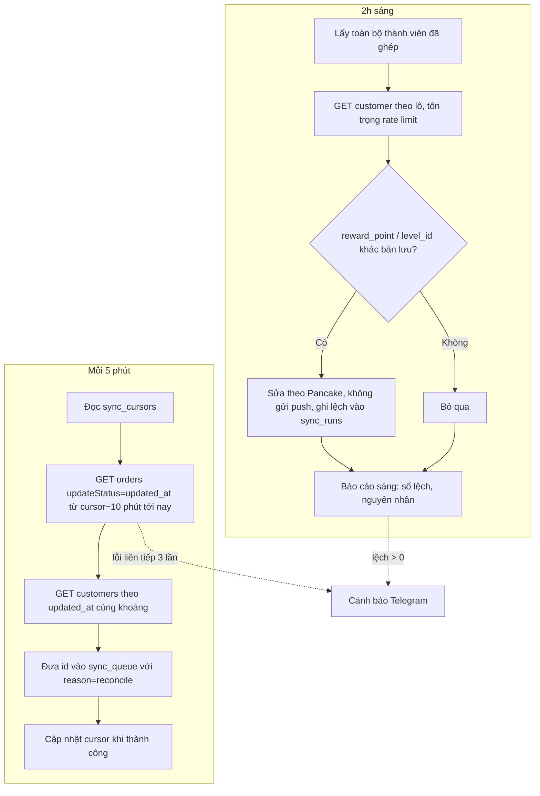
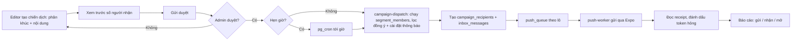
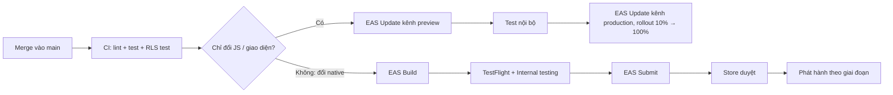

# 09 — Phân tích luồng hoạt động

> MiwaCare · v1 · 2026-11-25 · Mã luồng `AF-xx`. Đây là các luồng ở mức hệ thống (ai gọi ai, theo thứ tự nào), bổ sung cho luồng người dùng trong `04`.

## AF-01. Đăng nhập OTP

## AF-02. Ghép thành viên với khách Pancake

## AF-03. Đồng bộ realtime khi có đơn mới tại quầy

## AF-04. Đối soát

Cửa sổ chồng lấn 10 phút giúp không bỏ sót bản ghi nằm ở biên thời gian.

## AF-05. Cập nhật hồ sơ

1. App gửi hồ sơ mới tới `member-profile` (đã kiểm tra bằng zod).
2. Function cập nhật `members`.
3. Khoá theo khách → `GET` khách Pancake → gộp trường → `PUT` → `GET` xác nhận.
4. Ghi `audit_logs`, trả kết quả. Nếu Pancake lỗi: vẫn lưu ở MiwaCare, đưa việc ghi Pancake vào hàng đợi.

## AF-06. Gửi chiến dịch

## AF-07. Xoá tài khoản

1. Khách xác nhận bằng OTP (trong app hoặc trên web F-92).
2. `account-delete`: đặt `deleted_at`, thu hồi mọi phiên, vô hiệu `devices`, huỷ mọi push đang chờ.
3. Gỡ tag `app_member` trên Pancake (theo quy tắc ghi an toàn).
4. Ghi `audit_logs` và `consents` (rút toàn bộ đồng ý).
5. Sau 30 ngày, job xoá cứng: `members`, `devices`, `member_interests`, `inbox_messages`, `campaign_recipients`. Dữ liệu 🟦 bản sao Pancake của khách đó cũng bị xoá khỏi MiwaCare.
6. Giữ lại: bằng chứng đồng ý và nhật ký xoá (không có dữ liệu nhận dạng ngoài mã băm SĐT) để chứng minh tuân thủ.

## AF-08. Phát hành bản cập nhật app

