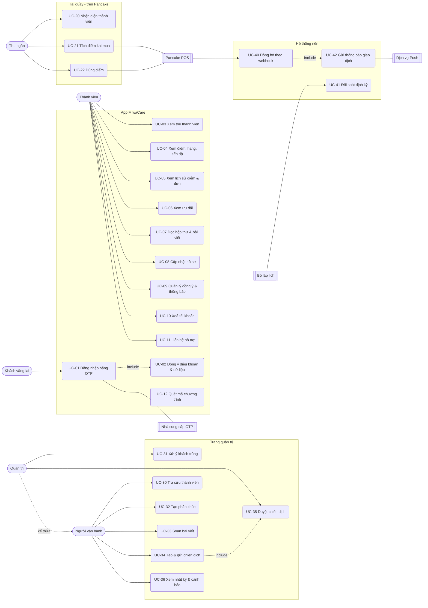

# 10 — Sơ đồ và đặc tả Use case

> MiwaCare · v1 · 2026-11-25 · Mã use case `UC-xx`, dẫn chiếu chức năng `F-xx` (`03`) và luồng `AF-xx` (`09`).

## 1. Tác nhân

| Tác nhân | Loại | Mô tả |
|---|---|---|
| Khách vãng lai | Người | Đã cài app, chưa đăng nhập |
| Thành viên | Người | Đã đăng nhập và ghép với khách Pancake |
| Thu ngân | Người | Thao tác trên Pancake POS (ngoài MiwaCare) |
| Người vận hành (Editor) | Người | Soạn nội dung, phân khúc, chiến dịch |
| Quản trị (Admin) | Người | Như Editor + duyệt gửi, quản lý người dùng quản trị, xử lý khách trùng |
| Pancake POS | Hệ thống | Nguồn gốc của khách, đơn, điểm, hạng |
| Bộ lập lịch | Hệ thống | Chạy đối soát và gửi chiến dịch hẹn giờ |
| Nhà cung cấp OTP | Hệ thống | SMS brandname / Zalo ZNS |
| Dịch vụ Push | Hệ thống | Expo Push → APNs / FCM |

## 2. Sơ đồ use case

## 3. Đặc tả use case chính

### UC-01 Đăng nhập bằng OTP
- **Tác nhân:** Khách vãng lai · **Chức năng:** F-02, F-04, F-05
- **Tiền điều kiện:** có mạng, SĐT Việt Nam hợp lệ.
- **Luồng chính:**
  1. Khách nhập SĐT → hệ thống chuẩn hoá và kiểm tra giới hạn gửi.
  2. Hệ thống gửi OTP qua nhà cung cấp.
  3. Khách nhập OTP đúng → hệ thống tạo phiên đăng nhập.
  4. Hệ thống ghép khách Pancake (AF-02).
  5. Lần đầu: chuyển sang UC-02, rồi hoàn thiện hồ sơ.
  6. Vào Trang chủ.
- **Luồng thay thế:** 3a. OTP sai: báo lỗi, đếm số lần; sai lần thứ 5 thì khoá 15 phút. · 4a. Chưa có trên Pancake: tạo mới. · 4b. Trùng: chuyển sang S-06 và tạo việc cho UC-31.
- **Hậu điều kiện:** có `members` gắn `pancake_customer_id` (trừ trường hợp 4b).

### UC-02 Đồng ý điều khoản và dữ liệu
- **Luồng chính:** hiển thị 3 ô (1 bắt buộc, 2 tuỳ chọn, mặc định không tick) → khách xác nhận → ghi `consents` (mục đích, giá trị, phiên bản chính sách, thời điểm, thiết bị).
- **Ngoại lệ:** không tick ô bắt buộc thì không vào được app. Khi chính sách đổi phiên bản, hỏi lại lần mở app kế tiếp.

### UC-03 Xem thẻ thành viên
- **Luồng chính:** mở Trang chủ → thẻ hiện dữ liệu đã lưu ngay lập tức → đăng ký realtime → có thay đổi thì cập nhật số. Thẻ không có mã khách; chạm thẻ → S-20 / lịch sử điểm.
- **Ngoại lệ:** mất mạng thì hiện dữ liệu đã lưu kèm "cập nhật lúc…".

### UC-12 Quét mã chương trình (giai đoạn sau)
- **Luồng chính:** chạm nút Quét giữa thanh tab (S-32) → quét QR hoặc nhập mã → `program-claim` kiểm tra → S-33 báo thành công, quà lưu vào Ưu đãi.
- **Ngoại lệ:** mã sai / hết hạn / hết lượt / đã nhận → báo lý do; quá 5 lần sai trong 10 phút thì tạm khoá nhập mã; khách từ chối quyền camera → vẫn nhập mã tay được.

### UC-10 Xoá tài khoản
- **Luồng chính:** xác nhận cảnh báo → OTP → hệ thống đánh dấu xoá, huỷ phiên và token push, gỡ tag `app_member` trên Pancake, lên lịch xoá cứng sau 30 ngày → đăng xuất.
- **Hậu điều kiện:** khách không còn nhận tin; dữ liệu mua hàng vẫn nằm trên Pancake (BR-11).

### UC-21 Tích điểm khi mua (ngoài MiwaCare, ảnh hưởng tới MiwaCare)
- **Luồng chính:** thu ngân tìm khách bằng SĐT → tạo đơn → thanh toán → Pancake cộng điểm → Pancake bắn webhook → UC-40 → UC-42.
- **Yêu cầu với MiwaCare:** điểm mới hiện trên app trong 10 giây (p95).

### UC-31 Xử lý khách trùng
- **Tác nhân:** Admin · **Chức năng:** F-73
- **Luồng chính:** mở danh sách → xem các khách Pancake cùng SĐT → gộp khách **trên Pancake** → chọn khách còn lại trong MiwaCare → hệ thống ghép và báo cho thành viên "Tài khoản đã sẵn sàng".

### UC-34 Tạo và gửi chiến dịch
- **Tác nhân:** Editor (soạn), Admin (duyệt) · **Chức năng:** F-74, F-76
- **Luồng chính:** chọn phân khúc → hệ thống tính số người nhận (đã lọc theo đồng ý) → chọn nội dung và kênh → chọn thời điểm → gửi duyệt → Admin duyệt → hệ thống đưa vào hàng đợi gửi → ghi kết quả.
- **Ngoại lệ:** phân khúc 0 người thì không cho gửi. Chiến dịch khuyến mãi tự loại khách chưa đồng ý.

### UC-40 Đồng bộ theo webhook
- **Luồng chính:** xem AF-03 trong `09`.
- **Hậu điều kiện:** `members`, `orders`, `point_logs` khớp Pancake; có sự kiện "điểm thay đổi" thì kích hoạt UC-42.

### UC-41 Đối soát định kỳ
- **Luồng chính:** xem AF-04 trong `09`. Có lệch thì sửa theo Pancake, ghi nhật ký và cảnh báo.

## 4. Ma trận use case – chức năng – màn hình

| UC | Chức năng | Màn hình / thành phần |
|---|---|---|
| UC-01 | F-02, F-04, F-05, F-08 | S-02, S-03, S-05, S-06 |
| UC-02 | F-03 | S-04 |
| UC-03 | F-10 | S-10, S-20 |
| UC-12 | F-25, F-81 | S-32, S-33 |
| UC-04 | F-11, F-12 | S-20, S-22 |
| UC-05 | F-13, F-14 | S-23, S-24, S-25 |
| UC-06 | F-20, F-21 | S-30, S-31 |
| UC-07 | F-22, F-23 | S-40, S-41 |
| UC-08 | F-30 | S-51 |
| UC-09 | F-31–F-33 | S-52–S-54 |
| UC-10 | F-07 | S-58, F-92 (web) |
| UC-11 | F-34 | S-56 |
| UC-30–36 | F-70–F-79 | Trang quản trị |
| UC-40–42 | F-50–F-57 | Backend |
