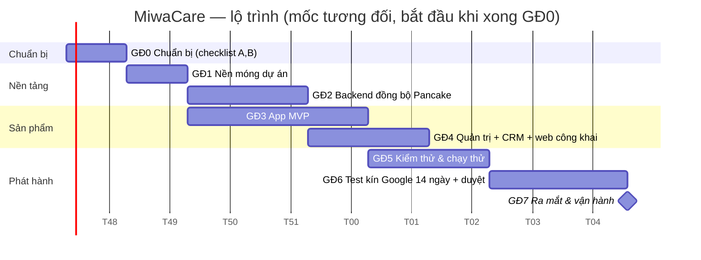

# 11 — Kế hoạch triển khai

> MiwaCare · v1 · 2026-11-25
> Người làm: **Bạn** (chủ dự án) · **Khách** (chủ thương hiệu) · **Claude** (kỹ thuật).
> Thời gian tính theo tuần kể từ khi xong **Giai đoạn 0**. Ước lượng cho một người làm kỹ thuật cùng Claude; tuỳ tốc độ phản hồi và duyệt nội dung.

## Tổng quan

Tổng: khoảng **9–11 tuần** từ lúc bắt đầu code tới khi lên store.

---

## GĐ0. Chuẩn bị (trước khi code)
**Mục tiêu:** đủ quyết định và quyền truy cập. Chi tiết trong `00-checklist-chuan-bi.md`.

| # | Việc | Người | Kết quả |
|---|---|---|---|
| 0.1 | Chốt quy tắc điểm, hạng, kênh bán (A1–A5) | Khách | Sửa các mục [GIẢ ĐỊNH] trong `02` |
| 0.2 | Duyệt danh sách chức năng `03` (Must/Should/Could) | Bạn + Khách | `03` được chốt |
| 0.3 | Khoá API Pancake + Shop ID; shop thử | Bạn | Điền `.env` |
| 0.4 | Tạo tài khoản Supabase, Expo, GitHub, Cloudflare (gói miễn phí, bật 2FA) | Bạn | |
| 0.5 | Mở tài khoản Apple Individual + Google Personal | Bạn | Mở sớm |
| 0.6 | Đăng ký SMS brandname / Zalo ZNS | Bạn / Khách | Chạy song song, chưa chặn code |
| 0.7 | Bộ nhận diện: logo, màu, font (C1–C5) | Khách | Điền TBD trong `05` |
| 0.8 | Danh sách 15–20 người test Android | Bạn | |

**Cổng chất lượng:** xong 0.1–0.4 thì mới sang GĐ1.

## GĐ1. Nền móng dự án — 1 tuần
| # | Việc | Người | Tiêu chí xong |
|---|---|---|---|
| 1.1 | Tạo monorepo (`apps/mobile`, `apps/admin`, `packages/*`, `supabase/`) | Claude | Chạy được trên máy |
| 1.2 | CI: lint, typecheck, test | Claude | Chạy khi có pull request |
| 1.3 | Supabase dev + staging; migration đầu tiên (bảng `06` mục 4) + RLS | Claude | Test RLS đạt |
| 1.4 | Token thiết kế + bộ component cơ bản (`05`) | Claude | Màn hình xem thử component |
| 1.5 | Gói `packages/pancake`: client, chuẩn hoá, retry, rate limit | Claude | Gọi được shop thử |
| 1.6 | **Thí nghiệm trên shop thử:** ghi lại trạng thái đơn thực tế, payload webhook, `PUT reward_point` có tạo log không | Claude + Bạn | Ghi kết quả vào `docs/pancake/thi-nghiem.md` |
| 1.7 | Sentry cho app, admin, function | Claude | Nhận được lỗi thử |

## GĐ2. Backend đồng bộ Pancake — 2 tuần
| # | Việc | Chức năng | Tiêu chí xong |
|---|---|---|---|
| 2.1 | Nạp dữ liệu ban đầu (khách, hạng, đơn 12 tháng) | F-58 | Chạy lại không trùng |
| 2.2 | `pancake-webhook` + `sync_queue` | F-50 | Trả 200 < 1 giây |
| 2.3 | `sync-worker` | F-51 | Đơn mới trên shop thử → Postgres < 10 giây |
| 2.4 | `reconcile` gần + đêm | F-53, F-54 | Tắt webhook 1 giờ vẫn bắt kịp; báo cáo lệch |
| 2.5 | `catalog-sync` | F-55 | |
| 2.6 | `member-link`, `member-profile` | F-04, F-52 | Đủ 3 trường hợp: khớp / mới / trùng |
| 2.7 | Trigger điểm thay đổi → inbox + push | F-15, F-56 | Push tới máy thật |
| 2.8 | Cảnh báo Telegram | F-57 | |
| 2.9 | `otp-sms-hook` (nối nhà cung cấp khi có; dev dùng số test) | F-02 | |

## GĐ3. App MVP — 3 tuần (song song với GĐ2 từ tuần 2)
| Tuần | Việc | Màn hình | Chức năng |
|---|---|---|---|
| 1 | Điều hướng, chào, OTP, đồng ý, hồ sơ, đăng xuất | S-01–S-06 | F-01–F-06, F-08 |
| 2 | Trang chủ, thẻ, hạng, lịch sử điểm và đơn, realtime | S-10, S-20, S-22–S-25 | F-10–F-15, F-24 |
| 3 | Ưu đãi, hộp thư, bài viết, deep link; tài khoản, đồng ý, thông báo, hỗ trợ, pháp lý, xoá tài khoản | S-30–S-58 | F-16, F-20–F-23, F-30–F-35, F-07 |

**Tiêu chí xong GĐ3:** mọi chức năng Must chạy trên 1 iPhone + 1 Android thật với dữ liệu shop thử; đủ các trạng thái trong `04` mục 5.

## GĐ4. Quản trị + CRM + web công khai — 2 tuần
| # | Việc | Chức năng |
|---|---|---|
| 4.1 | Đăng nhập 2FA, phân vai, nhật ký thao tác | F-70, F-79 |
| 4.2 | Thành viên, khách trùng | F-72, F-73 |
| 4.3 | View RFM + trình tạo phân khúc | F-74 |
| 4.4 | Bài viết, nội dung tĩnh | F-75, F-78 |
| 4.5 | Chiến dịch: soạn → duyệt → gửi / hẹn giờ → báo cáo | F-76, F-77 |
| 4.6 | Web công khai: chính sách, điều khoản, xoá tài khoản | F-90–F-92 |
| 4.7 | Tổng quan | F-71 |

## GĐ5. Kiểm thử và chạy thử — 2 tuần
| # | Việc | Người |
|---|---|---|
| 5.1 | Test end-to-end các luồng chính (Maestro) | Claude |
| 5.2 | Rà bảo mật theo checklist `07` mục 3 | Claude + Bạn |
| 5.3 | Chuyển sang shop Pancake thật ở **chế độ chỉ đọc**, nạp dữ liệu, chạy đối soát 7 ngày | Claude + Bạn |
| 5.4 | Cho 5–10 nhân viên / khách thân quen dùng thử (TestFlight + Internal testing) | Bạn |
| 5.5 | Hướng dẫn thu ngân tìm khách bằng SĐT và nhận biết khách dùng app (tag `app_member`) | Bạn + Khách |
| 5.6 | Chính sách bảo mật, điều khoản được duyệt, đã công khai | Khách + luật sư |
| 5.7 | Chuẩn bị hồ sơ store: ảnh chụp màn hình, mô tả, nhãn quyền riêng tư, Data safety, tài khoản demo | Claude + Bạn |

**Cổng chất lượng:** đối soát 7 ngày 0 lệch; p95 độ trễ < 10 giây; không còn lỗi nghiêm trọng.

## GĐ6. Test kín Google + duyệt store — ~2–3 tuần
| # | Việc | Ghi chú |
|---|---|---|
| 6.1 | Google: phát hành Closed testing, **≥ 12 người test trong 14 ngày liên tục** | Bắt buộc với tài khoản cá nhân mới |
| 6.2 | Apple: nộp duyệt (thường 1–3 ngày) | Có thể phát hành iOS trước |
| 6.3 | Sửa theo phản hồi người duyệt | |
| 6.4 | Google: xin quyền phát hành Production sau 14 ngày | |

## GĐ7. Ra mắt và vận hành
- Phát hành theo giai đoạn (10% → 50% → 100%).
- Truyền thông tại quầy: standee QR tải app, thu ngân nhắc khách.
- Tuần đầu: theo dõi hằng ngày (crash, đối soát, OTP lỗi, phản hồi khách).
- Sau đó theo lịch bảo trì `01` mục 7.

## Giai đoạn 2 (sau ra mắt, khi có số liệu)
- Đổi điểm lấy voucher trong app (`01` mục 2.4, dựa trên kết quả thí nghiệm 1.6).
- Ưu đãi riêng theo phân khúc tự động (sinh nhật, khách sắp rời).
- Chuyển app sang tài khoản công ty khi đã lập công ty.

---

## Ma trận trách nhiệm (RACI rút gọn)

| Hạng mục | Bạn | Khách | Claude |
|---|---|---|---|
| Quy tắc điểm, hạng, ưu đãi | C | **A/R** | I |
| Phạm vi chức năng | **A** | C | R |
| Tài khoản dịch vụ, khoá API | **A/R** | C | I |
| Thiết kế giao diện | A | C (duyệt) | **R** |
| Code app, backend, admin | A | — | **R** |
| Nội dung (thể lệ, bài viết, FAQ) | A | **R** | C |
| Chính sách bảo mật, pháp lý | **A** | R | C |
| Hồ sơ và nộp store | **A** | C | R |
| Vận hành CRM, gửi tin | A | **R** | C |
| Giám sát kỹ thuật, sự cố | **A** | I | R |

R = làm · A = chịu trách nhiệm cuối · C = được hỏi ý kiến · I = được thông báo.

## Quy trình làm việc mỗi tuần
1. Đầu tuần: chọn việc từ bảng của giai đoạn hiện tại.
2. Mỗi việc là một nhánh Git + pull request, CI phải xanh.
3. Cuối tuần: demo trên điện thoại thật (Expo Go / development build), cập nhật trạng thái trong tài liệu này.
4. Mọi thay đổi quyết định nghiệp vụ được ghi lại vào `02` hoặc `03` (có ngày).
